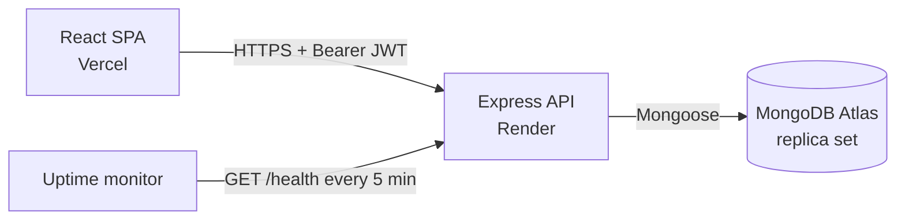

# PayZip: a digital wallet with atomic transfers

[](https://github.com/samarthsgithub/Paytm/actions/workflows/ci.yml)

Full-stack wallet app: sign up, get a starting balance, find other users and send them money. Built with React, Express and MongoDB, with the money-movement path designed for correctness rather than just the happy case.

**Live:** set your Vercel URL here after deploying. The API runs on a free tier, so the first request after idle can take ~30-50s (the UI says so).



## Engineering highlights

- **Atomic, race-free transfers.** Debit and credit run in one MongoDB multi-document transaction. The debit is a conditional update (`balance >= amount`), so the check and the decrement are a single atomic operation and concurrent requests cannot overdraw an account. A test fires 10 parallel transfers and asserts money is conserved.
- **Idempotent payments.** Clients send an `idempotencyKey`; a unique partial index guarantees a retried request after a timeout moves money once.
- **Exact money arithmetic.** Balances are stored as integer paise, never floats. Amounts are validated (positive, max 2 decimals, upper limit).
- **Security basics done properly.** bcrypt password hashing, JWTs with expiry, `helmet`, strict CORS allow-list, rate limiting on auth routes, request size limits, schema validation (Zod) on every input, no user enumeration on signin, regex-escaped search, field allow-listing on profile updates.
- **Resilient by design.** Central error handler and async wrapper (a bad request returns 4xx, never crashes the process), env validation at boot (fails fast with a clear message), graceful shutdown on SIGTERM, `/health` endpoint with a database ping.
- **Tested.** 18 integration tests (Jest + Supertest) against an in-memory MongoDB replica set, run in CI together with frontend lint and build.
- **Ops-ready.** Twelve-factor config, Dockerfile, `docker-compose.yml` with a replica-set Mongo, Render blueprint (`render.yaml`), GitHub Actions CI.
- **Frontend UX.** Protected routes, one Axios client (token injection, 401 handling, friendly error messages), debounced search, transaction history, loading and "server waking up" states.

## Architecture

```
backend/src
  app.js            express app (middleware, routes) - exported for tests
  server.js         DB connection, listen, graceful shutdown
  config/env.js     Zod-validated environment
  models/           User, Account, Transaction (Mongoose)
  routes/           auth, user, account
  middleware/       auth (JWT), validate (Zod), errorHandler
frontend/src
  lib/api.js        Axios client + error helpers
  pages/            home, signup, signin, dashboard, modals
  components/       navbars, ProtectedRoute, ErrorBanner
```

| Collection | Fields |
| --- | --- |
| `users` | email (unique, lowercase), username, passwordHash |
| `accounts` | userId (unique), balance (integer paise) |
| `transactions` | from, to, amount (paise), idempotencyKey (unique per sender), timestamps |

## API

Base path `/api/v1`. Authenticated routes need `Authorization: Bearer <token>`. Errors are `{ message, code }`.

| Method | Path | Auth | Description |
| --- | --- | --- | --- |
| GET | `/health` (no prefix) | no | Liveness + DB ping |
| POST | `/user/signup` | no | `{email, username, password (min 8)}`; creates user + wallet (Rs 1000) in a transaction |
| POST | `/user/signin` | no | Returns `{token}` |
| GET | `/user/me` | yes | Current user |
| PUT | `/user/update` | yes | `{username?, password?}` only |
| GET | `/user/bulk?filter=` | yes | Search other users (max 20) |
| GET | `/account/balance` | yes | Balance in rupees |
| POST | `/account/transfer` | yes | `{to, amount, idempotencyKey?}` |
| GET | `/account/transactions` | yes | Last 20 transactions |

## Run locally

```bash
# 1. MongoDB (needs a replica set for transactions)
docker compose up -d mongo

# 2. API
cd backend && cp .env.example .env     # set JWT_SECRET
npm install && npm run dev             # http://localhost:3000

# 3. Frontend
cd frontend && cp .env.example .env
npm install && npm run dev             # http://localhost:5173
```

Tests: `cd backend && npm test` (downloads a MongoDB binary on first run; set `MONGOMS_SYSTEM_BINARY=$(which mongod)` to use a local one).

## Deploy

1. **MongoDB Atlas:** create a free M0 cluster, add a database user, allow `0.0.0.0/0` under Network Access, copy the `mongodb+srv://` string and append a database name (e.g. `/payzip`).
2. **Render:** New -> Blueprint -> pick this repo (uses `render.yaml`). Set `MONGO_URI` and `CORS_ORIGINS` (your Vercel URL, no trailing slash). `JWT_SECRET` is generated for you. Confirm `https://<service>.onrender.com/health` returns `{"status":"ok"}`.
3. **Vercel:** import the repo, set **Root Directory** to `frontend`, add env var `VITE_API_URL=https://<service>.onrender.com`, deploy. Then put the Vercel URL into Render's `CORS_ORIGINS`.
4. **Keep it warm:** create a free [UptimeRobot](https://uptimerobot.com) HTTP monitor on `https://<service>.onrender.com/health` with a 5-minute interval. This also keeps the Atlas free cluster from being paused for inactivity.

## Possible next steps

Refresh tokens / httpOnly cookies, pagination on history, email verification, OpenAPI docs, frontend component tests.
